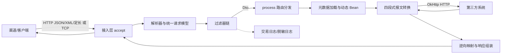

# 01 需求说明书

| 版本 | 日期 | 状态 |
|---|---|---|
| v1.0 | 2026-11-22 | 依据源码反向整理，含现状标注 |

## 1. 文档说明

### 1.1 编写目的

本文档从现有代码出发，完整描述 ESB / xRPC 统一接口网关的业务目标、范围边界、功能需求、非功能需求、数据需求和验收标准，作为概要设计、详细设计、测试与改造的依据。

### 1.2 读者

产品经理、业务方、架构师、开发工程师、测试工程师、运维工程师、安全合规人员。

### 1.3 参考资料

- 根目录 `pom.xml` 及各子模块 `pom.xml`
- `xrpc-module-accept-http`、`xrpc-module-accept-tcp`、`xrpc-module-process`、`xrpc-module-send-tcp` 源码
- `xrpc-common-*` 公共模块源码
- `application*.yml`、`redis.properties`、`logback.xml`
- 运行日志 `logs/ruoyi-file/info.*.log`

## 2. 项目背景与问题陈述

在现有业务环境中，多个渠道系统、第三方系统之间存在大量点对点对接。每次新增接口都需要重复开发协议解析、字段映射、加解密、流水号、限流和日志，导致：

1. 对接周期长，重复代码多；
2. 协议（JSON、XML、定长、TCP）差异散落在各业务系统中；
3. 缺乏统一的并发控制、上下架控制和审计能力；
4. 密钥、流水号、日志策略不统一，合规风险高。

本项目通过建设统一的 ESB 网关，把上述共性能力收敛到总线层，使“新接口上线”尽可能变成“元数据配置”。

## 3. 建设目标与成功标准

| 编号 | 目标 | 成功标准 |
|---|---|---|
| G-01 | 统一多协议接入 | HTTP 支持 JSON/XML/定长；TCP 支持 JSON/XML/定长三种独立接入进程 |
| G-02 | 配置化报文转换 | 新增接口主要通过配置 Tag 表完成，无需修改转换代码 |
| G-03 | 统一前置治理 | 渠道白名单、接口上下架、并发控制、时间戳、流水号防重、解密由统一过滤器链完成 |
| G-04 | 统一路由与出站 | 交易码决定处理 Bean 与目标地址，支持 HTTP 出站，具备 TCP 出站能力 |
| G-05 | 统一审计 | 全链路 serid、交易日志、敏感字段脱敏、日志开关可配置 |
| G-06 | 国产密码合规 | 支持 SM2 密钥交换、SM4 报文加解密 |
| G-07 | 可运维 | 配置与日志可热加载；部署、监控、扩容路径清晰 |

## 4. 干系人与角色

| 角色 | 关注点 | 当前系统对应入口 |
|---|---|---|
| 渠道对接方 | 请求报文格式、响应码、密钥获取 | `accept-http` 各 handler、`/initController/getcey` |
| 接口管理员 | 交易码、渠道、上下架、并发数、Tag 配置 | 数据库元数据表；当前缺少正式管理界面 |
| 运维 | 端口、配置热加载、日志、故障定位 | `application-static.yml`、文件监听、Logback |
| 安全合规 | 加密、脱敏、审计、权限 | SM2/SM4、`LogUtil`、`esb_tran_log` |
| 开发 | 扩展新交易、新过滤器、新协议 | `Service` 接口、`Filter` 接口、`StringMapServe` |

## 5. 业务范围与边界

### 5.1 范围内

- HTTP/TCP 协议适配与报文解析；
- 基于交易码的动态服务路由；
- 基于 Tag 元数据的 JSON/XML/定长双向映射；
- 渠道与接口的并发控制、启停控制、白名单校验；
- 时间戳校验、流水号唯一性校验、SM4 解密；
- HTTP 出站调用；独立的 TCP 出站服务；
- Java 原生序列化 + Redis 或本地 Map 的元数据缓存；
- 交易日志与日志脱敏。

### 5.2 范围外（当前不提供 / 待确认）

- 消息队列、异步削峰、事件驱动；
- 文件传输、批量文件处理；
- 分布式事务、补偿、 saga；
- 多租户与租户隔离；
- 管理后台前端与配置审批流；
- 服务注册发现、动态负载均衡、灰度发布（代码中有注释痕迹，未启用）；
- 链路追踪系统对接（仅生成本地 serid）；
- 监控告警平台对接。

## 6. 总体业务流程



## 7. 功能需求

### FR-01 多协议接入

| 项 | 内容 |
|---|---|
| 描述 | 系统应支持 HTTP 与 TCP 两类接入，报文格式支持 JSON、XML、定长（DC） |
| 现状 | 【部分实现】HTTP 三种 handler 已实现；TCP 三个独立进程已实现，但 json/xml 模块配置键缺失、TCP 响应帧格式不对称 |
| 证据 | `JsonController`、`XmlController`、`FixedLengthController`；`accept-tcp-json/xml/dc` 的 `NioServer` |
| 验收 | 三种格式均能通过 HTTP 与 TCP 完整收发，帧格式双方一致 |

### FR-02 统一请求与响应模型

| 项 | 内容 |
|---|---|
| 描述 | 不同协议接入后统一转换为 `CustomerReq`，内部传递使用 `Dto`，响应统一为 `CustomerRes` |
| 现状 | 【部分实现】JSON/XML/DC 均可构造 `Dto`；但 `XmlController`、`FixedLengthController`、`DefaultController` 未完整透传 `channelType`、`nonce`、`serid` |
| 证据 | `CustomerReq.java`、`Dto.java`、`CustomerRes.java` |
| 验收 | 任一入口进入 process 的 `Dto` 字段一致，serid 全链路可追踪 |

### FR-03 过滤器链

| 项 | 内容 |
|---|---|
| 描述 | 请求进入业务逻辑前按 `@Order` 执行过滤器，覆盖并发、渠道、上下架、时间戳、流水号、解密 |
| 现状 | 【部分实现】6 个 Filter 均存在，但 `@Order` 有重复（1 和 50），并发计数不完整，时间戳空值可绕过 |
| 证据 | `filter/impl/channel.java`、`UniqueSerialNumber.java`、`isChannel.java`、`Timestamp.java`、`isOpen.java`、`Decryption.java` |
| 验收 | 各规则可独立开关；顺序确定；并发计数在请求结束后正确释放 |

### FR-04 动态交易路由

| 项 | 内容 |
|---|---|
| 描述 | 按 `tranNo` 查 `CustomerTransactionInfo.clazz`，通过 Spring 容器获取处理 Bean 并执行 |
| 现状 | 【已实现】`ConfigAction.execute` + `SpringContext.getBean(clazz)` |
| 风险 | Bean 名来自数据库，缺少白名单与存在性校验 |
| 验收 | 交易码未配置、Bean 不存在时返回明确错误码而非 NPE |

### FR-05 元数据配置

| 项 | 内容 |
|---|---|
| 描述 | 通过 7 张元数据表描述渠道接口、渠道、第三方接口及四类 Tag |
| 现状 | 【已实现】实体与启动加载逻辑存在；【不足】无 DDL、无初始化数据、无热更新 |
| 证据 | `DataStructureCache`、`DataStructureRedis`、`datamodel/*` |
| 验收 | 提供 DDL 与配置样例；配置变更可按约定生效 |

### FR-06 报文双向转换

| 项 | 内容 |
|---|---|
| 描述 | 支持 String ↔ Map ↔ 模型 Map 的四段式转换，支持 JSON/XML/定长，支持嵌套 Object 与 List |
| 现状 | 【已实现】`MapConvert`、`StringMapServe`、`DCStringMapUtil`、`DCMapStringUtil` |
| 风险 | 递归无深度限制；定长字段按字符而非字节计算时中文可能越界 |
| 验收 | 提供 JSON/XML/定长各一组黄金报文回归样例 |

### FR-07 出站调用

| 项 | 内容 |
|---|---|
| 描述 | 转换后的第三方请求应支持 HTTP 与 TCP 两种出站方式 |
| 现状 | 【部分实现】`OKHTTPUtil` 已实现 HTTP 出站；`send-tcp` 独立服务实现 Socket 双工/单工，但 `process` 未调用它 |
| 证据 | `DefaultAbstractService` 仅调用 `OKHTTPUtil.postFormStr` |
| 验收 | 按交易配置可选择 HTTP 或 TCP 出站，均有超时与失败处理 |

### FR-08 加解密与密钥管理

| 项 | 内容 |
|---|---|
| 描述 | 渠道通过 SM2 公钥加密 SM4 Key，服务端用私钥解密后存入缓存；业务报文使用 SM4 加解密 |
| 现状 | 【部分实现】SM2 工具、SM4 工具、密钥初始化接口和解密过滤器均存在；但 Hash 名 `SMKEY`/`SIMKEY` 不一致，私钥路径硬编码 |
| 证据 | `InitController.getcey`、`Decryption.check`、`SM2Utils`、`SM4Utils` |
| 验收 | 密钥可配置、可轮换、按渠道隔离；加解密链路端到端通过 |

### FR-09 交易日志与审计

| 项 | 内容 |
|---|---|
| 描述 | 记录请求/响应流水号、渠道、交易码、起止时间、响应码，支持敏感字段脱敏与日志开关 |
| 现状 | 【部分实现】`LogServe` 与 `esb_tran_log` 已实现；但同步写库、同一实体两次 save、请求日志在过滤前写入 |
| 证据 | `LogServe.java`、`EsbTranLog.java`、`LogUtil.java`、`BizFlagCache.java` |
| 验收 | 一笔交易仅一条完整流水；日志写入不显著增加 RT；敏感字段全部脱敏 |

### FR-10 配置加载与热加载

| 项 | 内容 |
|---|---|
| 描述 | 静态配置来自 yml/properties；`cPort.json` 与 `logConfig.json` 支持文件变更热加载 |
| 现状 | 【部分实现】两个 JSON 文件有 WatchUtil 监听；元数据和数据库配置变更需重启 |
| 证据 | `PortMap`、`BizFlagCache`、`WatchUtil` |
| 验收 | 明确各类配置的生效方式，避免误改配置无效 |

### FR-11 管理接口

| 项 | 内容 |
|---|---|
| 描述 | 提供交易、渠道、Tag、端口映射、日志开关的查询与维护能力 |
| 现状 | 【未实现/隐患】`CrudBaseController` 提供通用 CRUD 基类但未挂载；一旦被子类继承即无鉴权暴露 |
| 证据 | `CrudBaseController.java` |
| 验收 | 管理接口有认证、授权、操作审计 |

### FR-12 并发与流量控制

| 项 | 内容 |
|---|---|
| 描述 | 按渠道和按交易码限制并发请求数，超限立即拒绝 |
| 现状 | 【部分实现】`channel` Filter 基于 `Static.nonce` 计数，但请求结束不释放，清理任务线程不安全 |
| 证据 | `channel.java`、`Static.java` |
| 验收 | 并发计数准确释放；限流算法明确；支持分布式部署 |

### FR-13 统一错误码

| 项 | 内容 |
|---|---|
| 描述 | 全链路使用统一、稳定、可文档化的错误码与响应结构 |
| 现状 | 【未实现】错误码散落且重复（`9999`、`999`、`9991` 多处复用），存在非数字码 `6s532` |
| 证据 | 见 `05-附录-错误码与配置项.md` |
| 验收 | 发布错误码字典；所有入口返回一致结构 |

### FR-14 可观测性与运维

| 项 | 内容 |
|---|---|
| 描述 | 提供健康检查、指标、链路追踪、统一日志与告警 |
| 现状 | 【未实现】仅有 AOP 耗时日志和本地 serid |
| 验收 | 暴露健康检查与核心指标；serid 跨进程透传 |

### FR-15 服务发现与负载均衡

| 项 | 内容 |
|---|---|
| 描述 | 多实例部署时支持服务发现与负载均衡 |
| 现状 | 【未实现】Nacos、LoadBalancerClient 相关代码均被注释，URL 写死在 `application-static.yml` |
| 验收 | 目标形态下地址不再硬编码 |

## 8. 非功能需求

| 编号 | 类别 | 需求 | 现状判断 |
|---|---|---|---|
| NFR-01 | 性能 | 明确单节点 TPS、P99 延迟、最大报文长度、最大并发 | 【未定义】 |
| NFR-02 | 可用性 | 明确 SLA、故障转移、降级、RTO/RPO | 【未定义】 |
| NFR-03 | 连接管理 | HTTP 客户端必须复用连接池；设置连接/读取超时 | 【部分实现】OkHttp 每次新建 Client |
| NFR-04 | 超时与 resilience | 设置超时、重试、熔断、隔离 | 【未实现】 |
| NFR-05 | 幂等 | 重复流水号在有效期和跨重启场景下均应被识别 | 【部分实现】Redis TTL 5 秒，map 模式内存存储 |
| NFR-06 | 安全认证 | 内部接口必须认证授权 | 【未实现】 |
| NFR-07 | 报文安全 | 验签、报文大小限制、XML 外部实体防护、递归深度限制 | 【未实现】签名字段仅定义未使用 |
| NFR-08 | 密钥安全 | 密钥不得硬编码；需支持轮换与销毁 | 【未实现】私钥路径写死 |
| NFR-09 | 数据安全 | 敏感字段脱敏；数据库密码不落明文 | 【部分实现】脱敏存在但配置开关；密码明文 |
| NFR-10 | 合规 | 满足等保/国密/审计留存要求 | 【待确认】 |
| NFR-11 | 可维护 | 消除重复模块、统一编码、补充文档与测试 | 【未实现】 |
| NFR-12 | 可观测 | 日志规范、指标、追踪、告警 | 【部分实现】 |
| NFR-13 | 兼容性 | Java 8、Spring Boot 2.7.x、MySQL/DB2 双库兼容 | 【部分实现】方言混用、jakarta/javax 混用 |
| NFR-14 | 部署 | 支持内嵌容器与外部 WAR 两种形态 | 【部分实现】accept-http 排除 Tomcat 并打 WAR |

## 9. 数据需求

### 9.1 元数据

- 渠道定义：`esb_customer_sysname`
- 渠道接口：`esb_customer_transaction_info`
- 渠道请求/响应 Tag：`esb_customer_request_tag`、`esb_customer_response_tag`
- 第三方接口：`esb_provider_transaction_info`
- 第三方请求/响应 Tag：`esb_provider_request_tag`、`esb_provider_response_tag`
- 交易日志：`esb_tran_log`

### 9.2 外部配置数据

- `cPort.json`：TCP 出站地址、端口、字符集、长度位宽、协议类型；
- `logConfig.json`：日志类型开关；
- `redis.properties`：Redis 读写地址与连接池；
- `application-static.yml`：模块间 URL、文件路径、缓存模式。

### 9.3 数据治理要求

1. 元数据变更需版本化并可回滚；
2. 交易日志需明确留存期与归档策略；
3. 敏感字段脱敏规则需可配置且可审计；
4. 缺少 DDL 与初始化数据，必须在落地前补齐。

## 10. 接口需求

### 10.1 渠道侧接口（现状）

| 路径 | 方法 | 输入 | 输出 | 说明 |
|---|---|---|---|---|
| `/controller/defaultHandler` | POST | `CustomerReq` 表单/对象 | `CustomerRes` | 通用入口，过滤器生效 |
| `/controller/jsonHandler` | POST | JSON 字符串 | JSON 字符串 | JSON 主入口，含日志与过滤器 |
| `/controller/xmlHandler` | POST | XML 字符串 | XML 字符串 | XML 入口，过滤器生效但日志不完整 |
| `/controller/fixedLengthHandler` | POST | 定长字符串 | 定长字符串 | 定长入口，当前未走过滤器链 |
| `/initController/getcey` | POST | `{channel,key}` | `CustomerRes.toString()` | SM2 解密并保存 SM4 Key |

### 10.2 内部接口（现状）

| 服务 | 路径 | 说明 |
|---|---|---|
| process | `/defaultController` | 接收 `Dto`，按交易码路由并执行转换 |
| send-tcp | `/controller/defaultController` | 参数 `tranNo`、`data`，按 `cPort.json` 转发至 TCP 目标 |

### 10.3 第三方接口需求

- 支持 HTTP `POST`，Content-Type 由元数据 `datatype` 与 `codeType` 决定；
- 支持 TCP 双工/单工，6 位长度头 + 报文体；
- 超时、失败码、报文编码需在接口契约中明确。

## 11. 约束与假设

1. 当前代码基于 Java 8 + Spring Boot 2.7.13；升级需评估 `javax`/`jakarta` 混用问题。
2. 静态配置含本机绝对路径（`E:\xsesb\...`、`d:/logs`），部署前必须参数化。
3. 数据库密码、Redis 地址等敏感信息当前明文存放，需纳入密钥管理。
4. 文档中的 DDL 为根据 JPA 实体反推的**建议结构**，需与实际库核对。
5. 多个仓库副本（`process` 与 `esb-service`）并存，需先确认唯一有效版本。

## 12. 验收标准

| 编号 | 验收项 | 标准 |
|---|---|---|
| AC-01 | 构建 | 根目录 `mvn clean package` 成功，无“子模块不存在”错误 |
| AC-02 | 接入 | 三种格式经 HTTP 与 TCP 均能完成同步请求/响应 |
| AC-03 | 路由 | 合法交易码命中 Bean；非法交易码返回明确错误码 |
| AC-04 | 转换 | JSON/XML/定长黄金报文回归通过，响应结构与配置一致 |
| AC-05 | 治理 | 过滤器规则逐项可验证；并发超限被拒绝且计数可恢复 |
| AC-06 | 安全 | 无认证接口不可访问公网；密钥不明文；敏感字段脱敏生效 |
| AC-07 | 日志 | 一笔交易一条完整流水，serid 可跨服务串联 |
| AC-08 | 运维 | 配置变更生效方式明确；健康检查可用 |
| AC-09 | 文档 | DDL、错误码、配置清单齐全且与代码一致 |

## 13. 风险与开放问题

1. **构建风险**：父 POM 模块路径错误，必须先修复才能持续集成。
2. **协议风险**：TCP 收发两端长度头约定不一致，需确认正确协议。
3. **数据风险**：元数据无热更新、无版本管理，误配置影响面大。
4. **容量风险**：NIO 单线程处理阻塞式 HTTP 调用，并发能力受限。
5. **合规风险**：密钥与敏感信息处理未满足常见等保要求。
6. **重复代码风险**：`process` 与 `esb-service` 并行维护，修复可能只落一处。
7. **开放问题**：详见 `README.md` 第 6 节。

## 14. 附录：报文样例

### 14.1 JSON 请求（渠道 → ESB）

```json
{
  "tranNo": "TRANNO001",
  "channel": "CH01",
  "nonce": "20220113111106500001",
  "timestamp": "202201131111060000",
  "digestAlgorithm": "SM3",
  "data": "{\"transaction\":{\"header\":{\"msg\":{\"seqNb\":\"111106500000497\"}},\"body\":{\"request\":{\"orderId\":\"O123\"}}}}"
}
```

### 14.2 JSON 响应（ESB → 渠道）

```json
{
  "code": "0000",
  "message": "成功",
  "data": { "response": { "returnCode": "000000", "returnMess": "成功" } }
}
```

### 14.3 TCP 帧格式（现状）

```text
[6 位 ASCII 长度][报文体]
000123{"tranNo":"TRANNO001", ...}
```

> 注意：当前 TCP 接入写响应时未附加长度头；目标设计应统一为相同帧格式。

### 14.4 Tag 配置样例

| tagname | parenttag | tagmapping | tagtype | tagvalue | sort | tagflag | taglength |
|---|---|---|---|---|---|---|---|
| transaction | TRANNO001 | transaction | Object |  | 1 | TOP |  |
| seqNb | TRANNO001.transaction.header.msg | seqNb | String |  | 1 |  |  |
| orderId | TRANNO001.transaction.body.request | orderId | String |  | 1 |  |  |
| returnCode | TRANNO001.response | retCd | String |  | 1 | code |  |

> 说明：`tagflag=code/message` 用于从第三方响应中提取返回码与描述；`TOP` 用于确定第一层节点。
