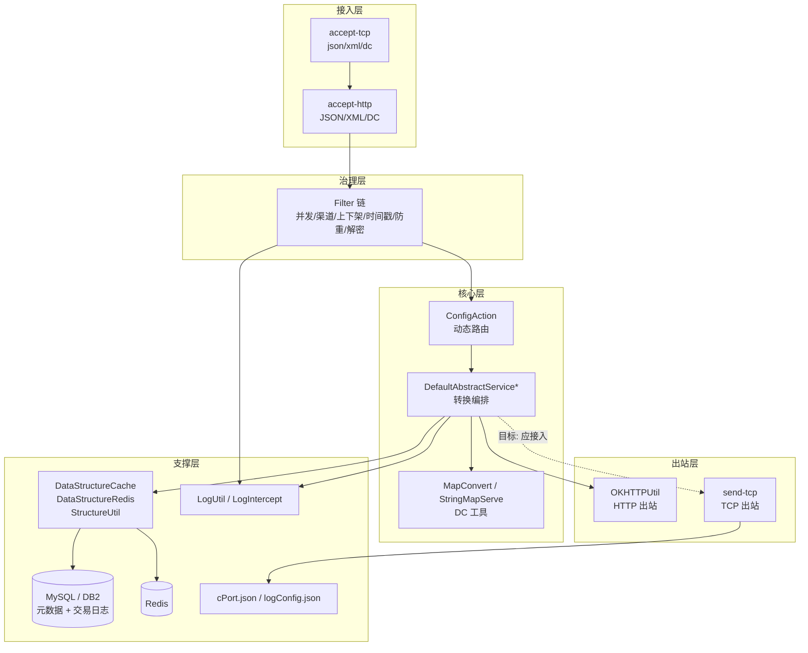
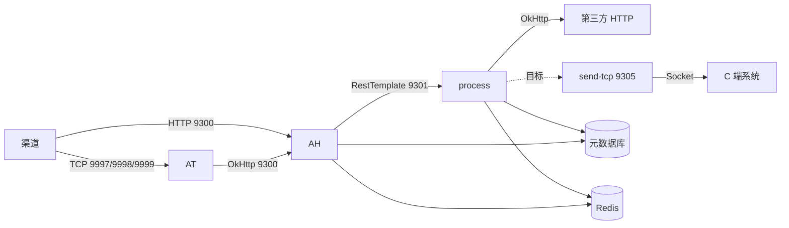
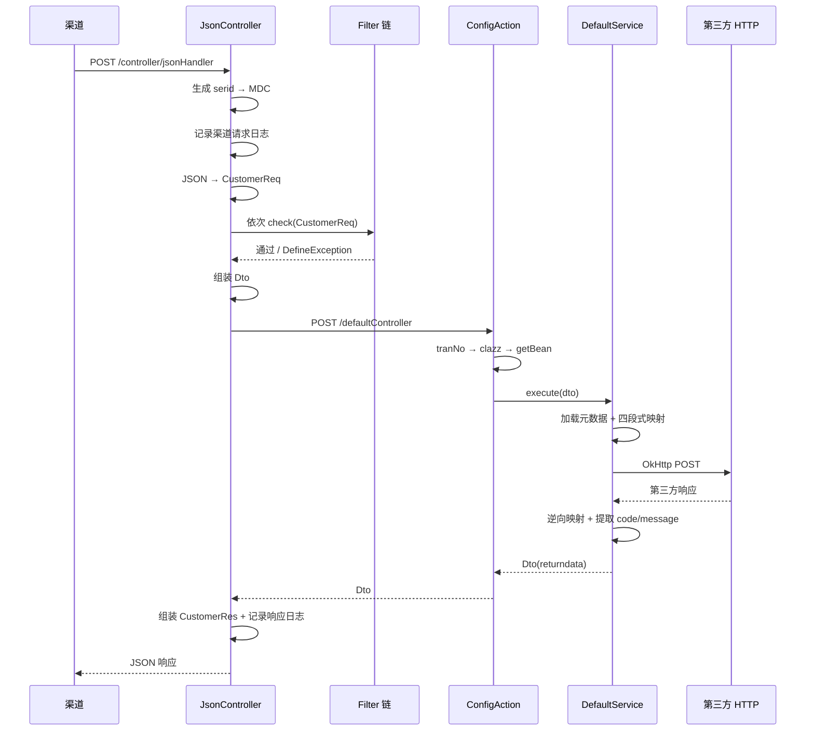
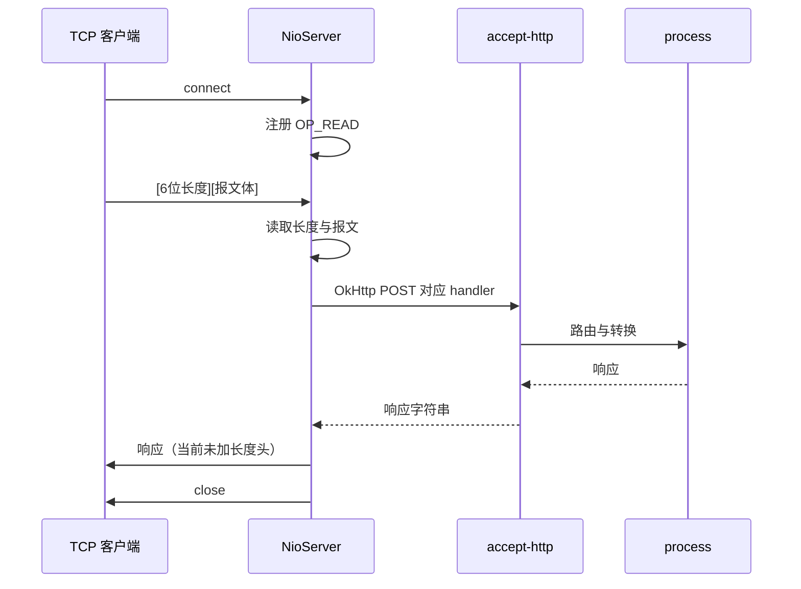
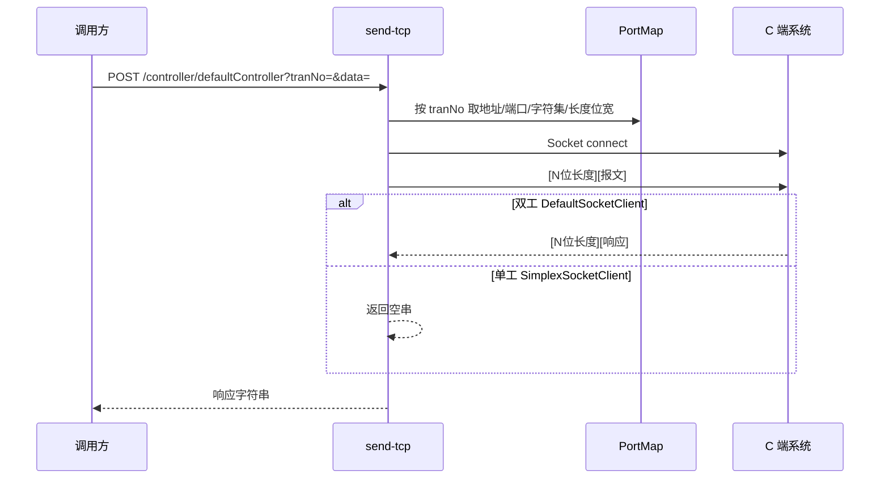
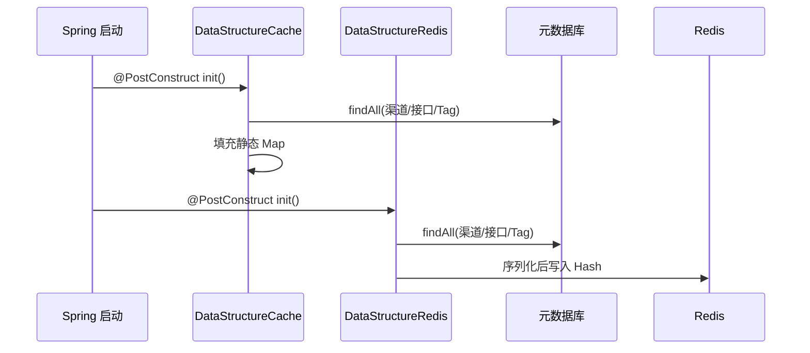
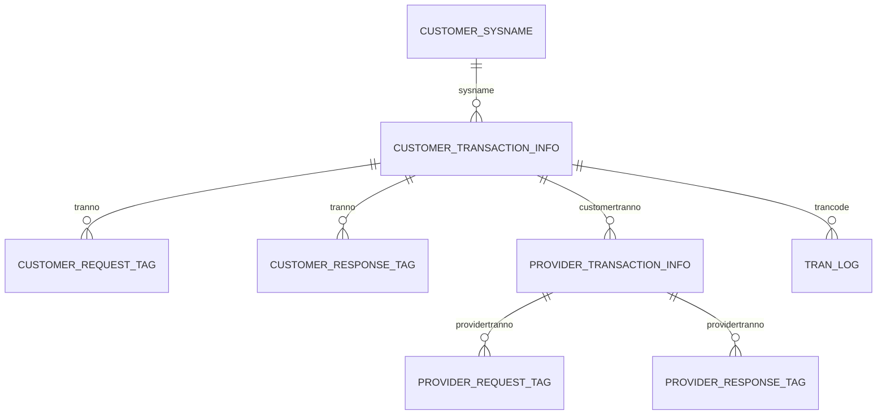

# 02 概要设计文档

| 版本 | 日期 | 状态 |
|---|---|---|
| v1.0 | 2026-11-22 | 依据源码反向整理；标注“现状/目标” |

## 1. 设计目标与原则

### 1.1 设计目标

1. **协议无关的核心**：核心转换逻辑不依赖 HTTP 或 TCP，接入层负责协议差异。
2. **元数据驱动**：报文结构、字段映射、目标地址由数据库/配置描述，而非硬编码。
3. **管道与过滤器**：横切治理能力通过可排序的 Filter 链插拔。
4. **路由与实现解耦**：交易码映射到 Bean 名称，由 Spring 容器提供具体处理逻辑。
5. **双形态缓存**：本地 Map 与 Redis 两种模式通过统一访问层切换。
6. **独立部署**：接入、转换、出站按进程拆分，可分别扩容。

### 1.2 设计原则

| 原则 | 当前体现 | 目标要求 |
|---|---|---|
| 高内聚低耦合 | 模块按接入/转换/出站拆分 | 出站协议应抽象为统一 SPI |
| 配置优于编码 | Tag 表驱动映射 | 补齐 DDL、热更新与版本管理 |
| 单一职责 | Filter 各自独立 | 确定顺序、拆分并发与防重职责 |
| 失败可见 | 有 DefineException 与日志 | 统一错误码与响应结构 |
| 可观测 | serid + AOP 耗时日志 | 跨进程追踪与指标 |

## 2. 架构总览

### 2.1 逻辑架构



### 2.2 运行视图

| 进程 | HTTP 端口 | TCP 监听 | 主要职责 | 现状 |
|---|---|---|---|---|
| `xrpc-module-accept-http` | 9300 | - | HTTP 接入、过滤器、日志 | 正常；按 WAR/WebLogic 设计 |
| `xrpc-module-process` | 9301 | - | 路由、转换、出站 | 正常；当前生效版本 |
| `xrpc-module-send-tcp` | 9305 | - | TCP 出站 | 独立可用，未被 process 调用 |
| `accept-tcp-dc` | 9304 | 9998 | 定长 TCP 接入 | 配置键正确 |
| `accept-tcp-json` | **9305** | 9999 | JSON TCP 接入 | HTTP 端口与 send-tcp 冲突；静态配置键缺失 |
| `accept-tcp-xml` | 9306 | 9997 | XML TCP 接入 | 静态配置键缺失 |

> 端口冲突与配置键问题详见 `04-现状差异与改造建议.md`。

### 2.3 部署视图



## 3. 模块划分与职责

| 模块 | 职责 | 关键包/类 | 依赖 |
|---|---|---|---|
| `xrpc-common-serve` | 通用 DTO、异常、工具、加解密、HTTP/Socket 工具、上下文 | `com.xs.dto.Dto`、`com.xs.serve.*`、`com.xs.sm.*`、`SpringContext` | web、okhttp、hutool、bcprov |
| `xrpc-common-crud` | 通用 JPA CRUD、动态 Specification、Repository 工厂 | `CrudBaseServiceImpl`、`SimpleSpecificationByBean`、`MyJpaRepositoryFactoryBean` | data-jpa、druid、serve |
| `xrpc-common-cache-datastructure` | 元数据实体、Repository、双缓存加载与访问 | `DataStructureCache`、`DataStructureRedis`、`StructureUtil` | crud、serve、redis |
| `xrpc-common-cache-cport` | TCP 端口映射与文件热加载 | `PortMap`、`CPort`、`WatchUtil` | commons-io |
| `xrpc-common-log` | 日志类型、开关、脱敏、日志配置热加载 | `LogType`、`LogUtil`、`BizFlagCache` | serve |
| `xrpc-common-intercept` | AOP 方法耗时 | `LogIntercept` | log |
| `xrpc-common-redis` | Jedis 读写池与工具 | `XsJedisPool`、`RedisUtils` | jedis 3.6.3 |
| `accept-http` | HTTP 接入 | 各 Controller、Filter、`Static`、`ConfigBean` | crud、cache-datastructure、log、intercept、redis |
| `accept-tcp-*` | TCP 接入 | `NioServer`、`NioInit`、`Static` | serve |
| `process` | 路由与转换核心 | `ConfigAction`、`DefaultAbstractService*`、`util.*` | crud、cache-datastructure、log、intercept |
| `send-tcp` | TCP 出站 | `ToCService`、`SocketClient`、`DefaultController` | serve、cache-cport |
| `esb-service` | 历史重复实现 | 与 process 相似 | 同 process |

### 3.1 包命名规范（现状）

所有模块共用根包 `com.xs`，模块间通过包路径区分：`com.xs.controller`、`com.xs.service`、`com.xs.util`、`com.xs.filter`、`com.xs.datamodel`、`com.xs.cache`、`com.xs.serve`、`com.xs.sm`。

> 目标建议：按模块使用独立根包，避免同名类冲突与组件扫描歧义。

## 4. 核心流程设计

### 4.1 HTTP JSON 同步交易（现状）



### 4.2 TCP 接入交易（现状）



### 4.3 TCP 出站交易（独立服务，现状）



### 4.4 元数据缓存加载（现状）



> 现状问题：两个 `@Component` 无论 `cache.cacheName` 取值如何都会初始化，map 模式下仍会写 Redis。

## 5. 技术选型

| 领域 | 选型 | 理由 | 现状评价 |
|---|---|---|---|
| 基础框架 | Spring Boot 2.7.13 | 生态成熟、Java 8 兼容 | 合理 |
| 微服务治理 | Spring Cloud 2021.0.8 / Alibaba 2021.0.5.0 | 预留 Nacos/Sentinel | 依赖已声明但功能被注释，未真正使用 |
| Web 容器 | 内嵌 Tomcat / 外部 WebLogic WAR | 适配不同部署环境 | accept-http 排除 Tomcat，其余未排除，形态不统一 |
| ORM | Spring Data JPA + Hibernate | 元数据为普通实体，CRUD 通用 | 合理；方言混用需清理 |
| 连接池 | Druid | 监控与连接池能力 | 部分模块有配置类，accept-http 依赖 starter |
| 缓存 | 本地 HashMap + Redis/Jedis | 无外部依赖与分布式两种模式 | 需要统一刷新与容错 |
| HTTP 客户端 | RestTemplate（内部）+ OkHttp（出站） | 两种场景 | OkHttp 每次新建 Client，需改进 |
| TCP | Java NIO（接入）+ Socket（出站） | 无第三方依赖 | 单线程 selector + 阻塞调用，需改进 |
| 国密 | Hutool + BouncyCastle | 支持 SM2/SM4 | 密钥管理缺失 |
| 日志 | Logback + MDC + AOP | 链路号与耗时 | 配置重复 root，路径硬编码 |

## 6. 关键机制设计

### 6.1 Tag 元数据模型（核心）

Tag 是一个树形结构的扁平化描述。父子关系通过 `parentTag` 的字符串路径表达：

```text
TRANNO001
└── transaction
    ├── header
    │   └── msg
    │       └── seqNb        tagMapping = transaction.header.msg.seqNb
    └── body
        └── request
            └── orderId      tagMapping = transaction.body.request.orderId
```

- 第一层节点的 `parentTag` 等于交易码，由虚拟 `TOP` 节点触发；
- 子节点 `parentTag = 父节点 parentTag + "." + 父节点 tagName`；
- `tagMapping` 使用点路径从源 Map 逐层取值（`MapUtil.getVal`）；
- `tagType` 决定构建方式：`String` 赋值、`Object` 递归、`List/SizeList` 遍历；
- `sort` 决定同级字段顺序，定长报文尤其关键；
- `tagflag` 承载语义：`code`/`message` 提取返回码，`nonce`/`timestamp`/`channel` 提取治理字段，`ListSizeCount` 提供定长列表数量。

目标设计应补充：
1. Tag 唯一约束（交易码 + 路径 + 标签名）；
2. 类型枚举与校验规则；
3. 配置变更版本与生效机制。

### 6.2 四段式映射

```text
渠道请求 String
   │  StringMapServe.stringMap(channelType, data, customerRequestTags)
   ▼
原始 Map
   │  MapConvert.mapperMap(tranNo, map, customerRequestTags)
   ▼
customer_req_map（渠道请求模型）
   │  MapConvert.mapperMap(providerTranNo, ..., providerRequestTags)
   ▼
provider_req_map（第三方请求模型）
   │  StringMapServe.mapString(providerDataType, ...)
   ▼
第三方请求 String → OkHttp → 第三方响应 String
   │
   └─ 逆向执行：stringMap → provider_res_map → customer_res_map → 渠道响应 String
```

扩展点（模板方法）：

- `update_customer_req_map()`：修正渠道请求模型；
- `update_provider_req_map()`：设置第三方请求头字段，如 `tranNo`；
- `update_sendQeury()`：调用前自定义处理；
- `update_provider_res_map()` / `update_customer_res_map()`：响应模型修正；
- `code_message_to_dto()`：从第三方响应提取返回码与描述。

### 6.3 动态路由

```java
String clazz = DataStructureCache.customerTransactionInfoMap.get(tranNo).getClazz();
Service service = (Service) SpringContext.getBean(clazz);
service.execute(dto);
```

目标设计应增加：Bean 白名单、存在性校验、未配置交易码的明确错误、按交易版本的环境隔离。

### 6.4 双缓存

| 模式 | 存储 | 读取 | 写入时机 | 局限 |
|---|---|---|---|---|
| `map` | 静态 `HashMap` | 直接 get | 启动 `@PostConstruct` | 无容量限制、无过期、无刷新、非线程安全写入场景 |
| `redis` | Hash + Java 原生序列化 | `RedisUtils.getHashKVForByte` + `SerializeUtil.unserialize` | 启动 `@PostConstruct` | 类版本敏感、无 TTL、读走写池 |

目标设计：抽象 `MetadataRepository`，统一刷新、版本号、失效通知与容错降级。

### 6.5 过滤器链

| 顺序（现状） | 过滤器 | 职责 | 目标调整建议 |
|---|---|---|---|
| 1 | `channel` | 渠道/接口并发计数 | 使用原子计数 + finally 释放；独立排序 |
| 1 | `UniqueSerialNumber` | 流水号防重 | 与 channel 顺序去重；统一存储与 TTL |
| 3 | `isChannel` | 渠道白名单与启停 | 保留 |
| 22 | `Timestamp` | ±10 分钟时间窗 | 空值必须拒绝 |
| 50 | `isOpen` | 接口上下架 | 提前到 channel 之前 |
| 50 | `Decryption` | SM4 解密 | 晚于参数校验，顺序确定 |

### 6.6 协议帧

- TCP 接入：6 位 ASCII 长度 + 报文体，一连接一请求，处理完成后关闭；
- TCP 出站：`CPort.fixedlength` 指定长度位宽，默认应按字节长度；
- HTTP 出站：`Content-Type = application/{datatype};charset={codeType}`。

目标设计应统一两端帧格式、增加最大报文限制、超时、半包/粘包处理。

### 6.7 日志与脱敏

- `LogType` 8 类日志由 `logConfig.json` 中的 `01`~`08` 开关控制；
- `BizFlagCache` 监听目录变更自动重载；
- `LogUtil` 按正则对身份证、银行卡、手机号、姓名脱敏；
- `LogIntercept` 用 AOP 记录 Controller/Service/Filter 耗时；
- 交易日志落 `esb_tran_log`，以 `tranflag`（serid）串联。

## 7. 数据架构



详细字段与 DDL 建议见 `03-详细设计.md` 第 7 章。

## 8. 非功能设计

### 8.1 性能

- 现状瓶颈：NIO 单线程内做同步 HTTP 调用；OkHttp 每次新建 Client；日志同步写库。
- 目标设计：接入层 NIO 仅负责收发，业务处理交给线程池；HTTP 客户端单例复用；日志异步化；增加批量与压缩能力。

### 8.2 可靠性

- 现状缺失：超时统一配置、重试、熔断、降级、幂等存储、事务补偿。
- 目标设计：统一客户端配置；按交易码配置重试与熔断；幂等键持久化；失败入死信/补偿队列。

### 8.3 安全

- 现状缺失：接口认证、验签、密钥轮换、报文大小限制、XXE 防护、配置加密。
- 目标设计：内部接口鉴权；签名字段真正参与验签；密钥托管；XML 解析禁用外部实体；敏感配置加密。

### 8.4 可观测性

- 现状：serid + 日志开关 + AOP 耗时。
- 目标：serid 跨进程透传；统一日志格式；指标（QPS/RT/错误率/并发数/缓存命中）；告警；链路追踪。

## 9. 演进路线（目标设计）

| 阶段 | 主题 | 关键动作 |
|---|---|---|
| 阶段一 | 修复阻断问题 | 修复 POM 模块路径、删除/归档重复模块、修正端口与配置键、修正 SMKEY/SIMKEY、补齐 TCP 长度头 |
| 阶段二 | 稳定性与正确性 | 并发计数释放、流水号持久化、元数据热更新、HTTP 客户端连接池、超时与错误码统一 |
| 阶段三 | 安全与合规 | 认证鉴权、验签、密钥管理、脱敏规则配置化、审计留存 |
| 阶段四 | 平台化 | 管理后台、配置审批、灰度发布、服务发现、监控告警、契约测试 |

## 10. 架构决策记录（摘要）

| 编号 | 决策 | 现状 | 建议 |
|---|---|---|---|
| ADR-01 | 使用 Tag 元数据而不是硬编码映射 | 已采用 | 保持，补齐校验与版本 |
| ADR-02 | 本地 Map / Redis 双缓存 | 已采用 | 抽象统一接口，支持刷新 |
| ADR-03 | 交易码映射 Bean 名 | 已采用 | 增加白名单与存在性校验 |
| ADR-04 | process 直接 HTTP 调用第三方 | 已采用 | 抽象出站 SPI，统一 HTTP/TCP |
| ADR-05 | 独立 TCP 接入进程 | 已采用 | 统一端口规划与帧协议 |
| ADR-06 | Nacos/Sentinel 预留但未启用 | 注释状态 | 明确启用或删除，避免误导 |
