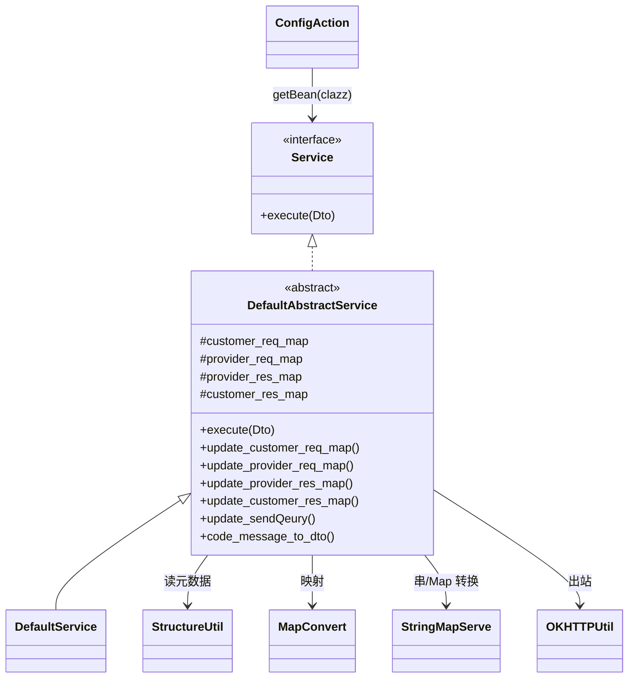

# 03 详细设计文档

| 版本 | 日期 | 状态 |
|---|---|---|
| v1.0 | 2026-11-22 | 依据源码反向整理；“目标建议”不代表现状 |

## 1. 文档说明

本文档对 ESB / xRPC 项目的核心类、算法、协议、数据结构、配置、并发与错误处理进行详细设计说明。与 `02-概要设计.md` 的关系是：概要设计描述“系统如何组织”，本文档描述“代码如何实现”。

约定：
- **现状**：直接来自源码；
- **目标建议**：为解决 `04-现状差异与改造建议.md` 中问题而提出的改进方案；
- 字段/方法名保持与源码一致。

## 2. 包结构与组件清单

```text
com.xs
├── context      SpringContext（静态获取 Bean）
├── dto          Dto、CustomerReq、CustomerRes、CPort
├── exception    DefineException
├── model        Tag
├── menu         LogType
├── filter       Filter 接口 + impl（6 个实现，位于 accept-http / esb-service）
├── controller   accept-http / process / send-tcp 各入口
├── service      Service 接口、DefaultAbstractService、DefaultService、ToCService
├── client       SocketClient + impl（send-tcp）
├── cache        DataStructureCache、DataStructureRedis、PortMap、BizFlagCache
├── datamodel    元数据实体与 Repository
├── db           CrudBaseService、DaoRepository、Specification、Repository 工厂
├── serve        OKHTTPUtil、SocketUtil、SerializeUtil、BeanMapUtil、LogUtil、json/*、StructureUtil
├── sm           SM2Utils、SM3Utils、SM4Utils
├── util         MapConvert、MapUtil、StringMapServe、DC*Util、RedisUtils、WatchUtil
├── config       Static、ConfigBean、BinFaBean、DruidDataSourceConfig
└── datasource   DruidDataSourceConfig
```

### 2.1 核心类关系



## 3. 核心模型详细设计

### 3.1 `CustomerReq`（渠道请求模型）

| 字段 | 类型 | 含义 | 校验现状 |
|---|---|---|---|
| `tranNo` | String | 业务交易号 | 仅 process 端判空 |
| `token` | String | token 验证 | 未使用 |
| `nonce` | String | 全局唯一流水号 | 由 Filter 校验 |
| `timestamp` | String | 时间戳 | 由 Filter 校验，空值可绕过 |
| `channel` | String | 渠道标识 | 由 Filter 校验 |
| `digestAlgorithm` | String | 数据摘要算法 | 未使用 |
| `data` | String | 业务数据（SM4 密文或明文） | 由 Filter 解密 |

### 3.2 `Dto`（内部传输模型）

| 字段组 | 字段 | 用途 |
|---|---|---|
| 治理 | `token`、`nonce`、`timestamp`、`channel`、`serid` | 链路与校验 |
| 报文 | `data`、`returndata`、`channelType` | 请求/响应业务数据 |
| 安全 | `key`、`sign`、`smSign`、`digestAlgorithm`、`version` | 仅定义，未参与逻辑 |
| 路由 | `tranNo`、`providerTransactionInfo`、`provider_url` | 交易与目标 |
| 转换中间态 | `map`、`customer_req_map`、`provider_req_map`、`provider_res_map`、`customer_res_map` | 四段式映射容器 |
| 结果 | `code`、`message`、`timefly` | 返回码与耗时 |

### 3.3 `CustomerRes`（渠道响应模型）

字段：`resultcode`、`resultmessage`、`code`、`message`、`timefly`、`data`、`key`、`version`、`sign`。

现状说明：
- `JsonController` 使用 `JSONObject(customerRes)` 输出对象字段；
- `InitController.getcey` 返回 `customerRes.toString()`，不是 JSON，属于协议缺陷。

### 3.4 `Tag`（报文标签元数据）

`Tag` 使用 `@MappedSuperclass`，是 4 张 Tag 表的公共父类。

| 字段 | 列名 | 类型 | 含义 |
|---|---|---|---|
| `tagName` | tagname | String | 标签名 |
| `parentTag` | parenttag | String | 父路径 |
| `tagMapping` | tagmapping | String | 源取值路径，点分 |
| `tagType` | tagtype | String | String/Object/List/SizeList/NoSizeList |
| `tagValue` | tagvalue | String | 固定值/默认值 |
| `sort` | sort | Integer | 排序 |
| `tagflag` | tagflag | String | 语义标记 |
| `taglength` | taglength | Integer | 定长长度 |

### 3.5 `DefineException`

继承 `RuntimeException`，携带 `code` 与标准 `message`。被各层抛出并在 Controller 层捕获转换为响应码。

问题：错误码未集中定义，存在重复与非数字编码。

## 4. 公共支撑组件详细设计

### 4.1 `SpringContext`

实现 `ApplicationContextAware`，保存静态 `ApplicationContext`，提供 `getBean(String)` / `getBean(Class)` / `getBean(String, Class)`。

用途：`ConfigAction` 按数据库配置的 Bean 名动态获取处理服务；`ToCService` 获取 `sendC`。

风险：静态持有容器；Bean 名来自数据库且未校验。

### 4.2 `StructureUtil`（缓存统一访问层）

```java
if (cacheName.equals("redis")) {
    return (X) SerializeUtil.unserialize(RedisUtils.getHashKVForByte(...));
} else if (cacheName.equals("map")) {
    return DataStructureCache.xxxMap.get(key);
}
return null;
```

| 方法 | 返回 | Redis Hash | 本地 Map |
|---|---|---|---|
| `getCusInfo(tranNo)` | `CustomerTransactionInfo` | `cusinfo` | `customerTransactionInfoMap` |
| `getCusReq(tranNo)` | `List<Tag>` | `cusreq` | `customerRequestTagMap` |
| `getCusRes(tranNo)` | `List<Tag>` | `cusres` | `customerResponseTagMap` |
| `getProInfo(tranNo)` | `ProviderTransactionInfo` | `proinfo` | `providerTransactionInfoMap` |
| `getProReq(tranNo)` | `List<Tag>` | `proreq` | `providerRequestTagMap` |
| `getProRes(tranNo)` | `List<Tag>` | `prores` | `providerResponseTagMap` |
| `getNonce/setNonce` | 防重 | 普通 KV，TTL 5 秒 | `nonce` Map |
| `getConnectCountByChannel` | `CustomerSysname` | `customerSysname` | `customerSysnameMap` |

风险：`cacheName` 为 null 时 `equals` 调用 NPE；Redis 模式读操作使用写连接池；Java 原生序列化对类版本敏感。

### 4.3 `DataStructureCache`（本地缓存）

- `@Component`，`@PostConstruct init()` 依次加载渠道、渠道接口、第三方接口与 Tag；
- 使用 `CrudBaseServiceImpl.findAll(实体)` 查询；
- 条件查询使用 `EQ_` 前缀，例如 `customertranno = "EQ_" + tranNo`；
- 静态 Map：7 个业务 Map + 1 个 nonce Map。

## 4.4 `DataStructureRedis`

与 `DataStructureCache` 结构相同，但把对象序列化后写 Redis Hash。**无论当前缓存模式为何，两个类都会随 Spring 启动初始化**。

### 4.5 `PortMap` / `CPort` / `WatchUtil`

- `CPort` 字段：`tranno`、`port`、`charset`、`address`、`fixedlength`、`type`、`str1~str5`；
- `cPort.json` 结构：`{"cPort":[{"trannos":["001"],"port":8888,"charset":"utf8","address":"127.0.0.1","fixedlength":8,"type":"DC"}]}`；
- `PortMap.init()` 用 `watchFile(cportfilepath)` 监听并加载；
- 现状缺陷：`watchFile` 接收的是文件路径，而 commons-io 的 `FileAlterationObserver` 需要目录。

### 4.6 `BizFlagCache` / `LogUtil` / `LogType` / `LogIntercept`

- `LogType`：`01` 渠道请求、`02` 返回渠道、`03` 第三方请求、`04` 第三方返回、`05` 转换主程序、`06` 转换辅助、`07` 耗时、`08` 解析标签；
- `logConfig.json` 形如 `{"01":"OK","02":"OFF"}`；
- `BizFlagCache` 监听父目录，文件变更后重载；
- `LogUtil.info` 按开关输出并按身份证/银行卡/手机号/姓名正则脱敏；
- `LogIntercept` 环绕 `com.xs.controller..*`、`com.xs.service..*`、`com.xs.filter..*`，记录开始与结束时间。

现状缺陷：结束日志打印了 `startTime` 而非 `endTime`；两个 `LogUtil` 实例字段均为 `static` 且未赋值，靠“类名调用静态方法”行为工作，属于代码坏味道。

### 4.7 `OKHTTPUtil`

| 方法 | 说明 | 超时 |
|---|---|---|
| `post(url, params, headers)` | 表单 POST | 连接 120s / 读取 60s |
| `postFormStr(url, type, params)` | 原始字符串 POST，默认编码 `UTF-8`（已修正原 `UFT-8` 拼写错误） | 同上 |
| `postFormStr(url, type, codeType, params)` | 指定 Content-Type 与编码 | 同上 |
| `postFormBody` | 表单 POST | 未设置超时 |
| `getData` | GET | 连接 120s / 读取 60s |

每次调用都 `new OkHttpClient()`，连接池无法复用；所有异常统一包装为 `DefineException("865", ...)`，丢失原始错误码。

### 4.8 `SerializeUtil`

Java 原生 `ObjectOutputStream/ObjectInputStream` 序列化。风险：无 `serialVersionUID` 一致性管理、无白名单、跨版本不兼容。

### 4.9 `BeanMapUtil`

提供 `objectToMap`、`mapToBean`（递归查找父类字段并做 Long/Integer/Float/Double 类型转换）、`getClassField`、`convertValType`。异常码包括 `86555`、`2347`、`8659`、`8651`、`8653`。

### 4.10 SM2 / SM3 / SM4

| 类 | 方法 | 说明 |
|---|---|---|
| `SM2Utils` | `generateKey`、`encrypt`、`decrypt`、`importPrivateKey`、`exportPrivateKey` 等 | SM2 密钥与加解密，基于 Hutool/BouncyCastle |
| `SM4Utils` | `sm4In_Base64`（加密）、`sm4Out_Base64`（解密） | SM4 对称加解密 |
| `SM3Utils` | 摘要 | 未接入验签流程 |

## 5. 接入层详细设计

### 5.1 控制器清单

| 类 | 路径 | 输入 → 输出 | 关键行为 |
|---|---|---|---|
| `JsonController` | `/controller/jsonHandler` | String(JSON) → String(JSON) | 生成 serid；记 QDREQ/QDRES；解析 CustomerReq；执行 Filter；调用 process；组装响应 |
| `XmlController` | `/controller/xmlHandler` | String(XML) → String(XML) | `XML.toJSONObject` 转 Map；执行 Filter；组装 `<transaction>` 响应 |
| `FixedLengthController` | `/controller/fixedLengthHandler` | 定长 String → 定长 String | 前 10 位交易码，其余为 data；直接调用 process，未执行 Filter |
| `DefaultController` | `/controller/defaultHandler` | CustomerReq → CustomerRes | 执行 Filter 后调用 process |
| `InitController` | `/initController/getcey` | `{channel,key}` → String | SM2 私钥解密 SM4 Key 并写 Redis Hash |
| `send-tcp DefaultController` | `/controller/defaultController` | `tranNo,data` → String | 调用 `ToCService.sendMess` |

### 5.2 `JsonController.handler` 流程

1. `serid = UUID.randomUUID().toString().replace("-","")`，`MDC.put("serid", serid)`；
2. `logUtil.info(LogType.QDREQ, log, json)`；
3. `new JSONObject(json)`，取出 `data` 并回写为字符串；
4. `BeanMapUtil.mapToBean(jsonObject.toMap(), CustomerReq.class)`；
5. `logServe.log(customerReq)` 写请求流水；
6. 遍历 `List<Filter>` 调用 `check`；
7. 组装 `Dto`（`channelType="JSON"`）并 `restTemplate.postForObject(Static.processurl, qdto, Dto.class)`；
8. 组装 `CustomerRes`，写响应流水，`JSONObject` 序列化返回。

异常分支：
- `ResourceAccessException` → `9991 / PROCESS系统未启动...`
- `DefineException` → 使用异常自身 code/message
- 其他 `Exception` → `9999 / e.getMessage()`

### 5.3 过滤器实现

| 类 | Order | 输入依赖 | 行为 | 缺陷 |
|---|---|---|---|---|
| `channel` | 1 | `StructureUtil.getCusInfo/getConnectCountByChannel` | 把请求加入 `Static.nonce`，按渠道/交易码计数，超限抛 `9433`/`2132` | 请求结束不释放；ArrayList 非线程安全；遍历中删除 |
| `UniqueSerialNumber` | 1 | `StructureUtil.getNonce/setNonce` | 流水号重复抛 `863` | 与 channel 同 Order；Redis TTL 5 秒；map 模式无过期 |
| `isChannel` | 3 | 接口 `sysName`、渠道 `flag` | 禁用渠道抛 `0999`；非白名单抛 `9999`；异常统一包成 `999` | 异常吞掉原始语义 |
| `Timestamp` | 22 | `dto.timestamp` | 18 位时间，±10 分钟窗口；空值放行 | 注释掉了空值拒绝逻辑 |
| `isOpen` | 50 | 接口 `isOpen` | 未上架抛 `98935`/`9895` | 与 Decryption 同 Order |
| `Decryption` | 50 | `isCryption`、Redis `SIMKEY` | SM4 解密 `dto.data` | Hash 名与初始化端不一致；仅入站解密 |

### 5.4 `Static`（accept-http）

- `processurl` 由 `${url.xrpc-module-process}` 注入；
- `nonce` 为 `ArrayList<BinFaBean>`；
- `@Scheduled(cron="0 0/3 * * * ?")` 的 `deleteGq()` 每 3 分钟清理超过 3 分钟的条目，但日志描述为 5 分钟，且跨小时计算错误、遍历中删除。

## 6. 核心转换层详细设计

### 6.1 `ConfigAction.execute(Dto)`

```java
String tranNo = dto.getTranNo();
if (tranNo == null || tranNo.equals("")) throw new DefineException("9991", "交接编号不能为空...");
String clazz = DataStructureCache.customerTransactionInfoMap.get(tranNo).getClazz();
Service service = (Service) SpringContext.getBean(clazz);
service.execute(dto);
```

- 捕获 `DefineException`：回写 code/message；
- 捕获其他异常：`3453`；
- 输出 QDREQ/QDRES 日志。

缺陷：未判空 `CustomerTransactionInfo`，未校验 `clazz`，未使用 `StructureUtil` 导致 redis 模式失效。

### 6.2 `Service` 接口

```java
public interface Service<T> {
    void execute(T t) throws DefineException;
}
```

### 6.3 `DefaultAbstractService`（当前生效）

原本地 Map 版（直读 `DataStructureCache`）已删除；其 Redis 版统一改名为 `DefaultAbstractService`，成为唯一实现。元数据读取全部经 `StructureUtil` 门面，按 `cache.cacheName` 在 `map` / `redis` 两种模式间切换。

`execute(Dto)` 步骤：

| 步骤 | 代码动作 | 输入 | 输出 |
|---|---|---|---|
| 1 | `StructureUtil.getCusInfo / getCusReq / getCusRes` | tranNo | 渠道接口与 Tag |
| 2 | `StructureUtil.getProInfo / getProReq / getProRes` | tranNo / providerTranNo | 第三方接口与 Tag |
| 3 | `StringMapServe.stringMap(channelType, data, customerRequestTags)` | 渠道报文 | 原始 Map |
| 4 | `MapConvert.mapperMap(tranNo, map, customerRequestTags)` | 原始 Map | `customer_req_map` |
| 5 | `update_customer_req_map()` | - | 扩展点 |
| 6 | `MapConvert.mapperMap(providerTranNo, customer_req_map, providerRequestTags)` | 渠道模型 | `provider_req_map` |
| 7 | `update_provider_req_map()` | - | 扩展点 |
| 8 | `StringMapServe.mapString(providerDataType, provider_req_map, providerRequestTags)` | 第三方模型 | 第三方请求串 |
| 9 | `update_sendQeury()` | - | 扩展点 |
| 10 | `OKHTTPUtil.postFormStr(provider_url 或 sendUrl, dataType, codeType, str)` | 请求串 | 第三方响应串 |
| 11 | `StringMapServe.stringMap(providerDataType, ...)` | 响应串 | `response_map` |
| 12 | `code_message_to_dto()` | `response_map` + Tag | `dto.code/message` |
| 13 | `MapConvert.mapperMap(tranNo, response_map, providerResponseTags)` | 响应 Map | `provider_res_map` |
| 14 | `MapConvert.mapperMap(tranNo, provider_res_map, customerResponseTags)` | 第三方模型 | `customer_res_map` |
| 15 | `StringMapServe.mapString(channelType, customer_res_map, customerResponseTags)` | 渠道模型 | `returndata` |

异常：`DefineException` 直接抛出；其他异常包装为 `06987 报文转化错误`。

### 6.5 `DefaultService`

唯一具体处理 Bean，注册名 `defaultService`，`@Scope("prototype")`。

- `update_provider_req_map()`：`provider_req_map.put("tranNo", providerTransactionInfo.getProviderTranNo())`；
- `code_message_to_dto()`：从 `providerResponseTags` 找 `tagflag=code` 与 `tagflag=message` 的 Tag，按 `tagMapping` 从 `response_map` 取值，找不到则抛 `092`。

> `filter(customerRequestTags)` 已从归档的 `esb-service` 版迁移进当前 `DefaultAbstractService`：在 `customer_req_map` 生成后按 `tagflag` 把 `nonce/timestamp/channel/digestAlgorithm` 回填到 Dto。

## 7. 映射工具详细设计

### 7.1 `MapConvert`

| 方法 | 说明 |
|---|---|
| `mapperMap(tranNo, datamap, tags)` | 创建虚拟 TOP 节点并递归构建结果 Map |
| `findChildTagToMapping(currentTag, mappingMap)` | 找子节点并逐个映射 |
| `getChildTagsByParentstr(currentTag)` | TOP 时按 `parentTag==tranNo`，否则按 `parentTag + "." + tagName` |
| `tagMappingVal(mappingMap, tag, dataMap)` | 按 `tagType` 分派：String/Object/List/SizeList |
| `listHandle(list, tags)` | 对列表中每个元素递归映射 |

异常统一为 `87342`。缺少递归深度限制和环检测。

### 7.2 `MapUtil.getVal(map, key, defaultValue)`

按 `.` 拆分 key 逐层取值；支持 String/Integer/Long/BigInteger/Float/Double/BigDecimal/List/HashMap；最后一层为 `v` 且值为 Map 时包装为单元素 List；取不到返回 `""`（不是 defaultValue）。异常码 `873242`。

### 7.3 `StringMapServe`

| 方法 | JSON | XML | DC |
|---|---|---|---|
| `stringMap(type, data, tags)` | `new JSONObject(data).toMap()` | `XML.toJSONObject(data,true).toMap()` | `DCStringMapUtil.dcStringMap(tags,data)` |
| `mapString(type, map, tags)` | `new JSONObject(map).toString()` | `XML.toString(new JSONObject(map))` | `DCMapStringUtil.dcMapString(tags,map)` |

异常码：`4675434`（入）、`4653434`（出）；XML 解析失败抛 `9999`。

### 7.4 定长工具

`DCStringMapUtil`：
- 入口 `dcStringMap(tags, dcStr)` 从第一个 Tag 的 `parentTag` 开始；
- 按 `sort` 排序后按 `taglength` 切分；
- `tagflag=ListSizeCount` 的字段解析为列表数量；
- `NoSizeList` 从当前位置读到结尾，按单元素长度循环；
- `SizeList` 按已读数量循环，递归解析子 Tag。

`DCMapStringUtil`：
- 按 `sort` 排序；
- `String` 用 `String.format("%{length}s", value)` 左补齐空格；
- `List` 递归拼接子报文。

风险：按字符数而非字节数；中文场景可能长度错误（项目已统一 UTF-8）；无截断保护。

## 8. TCP 层详细设计

### 8.1 `NioServer`

- `Selector.open()` + `ServerSocketChannel` 非阻塞，注册 `OP_ACCEPT`；
- 缓冲区固定 `ByteBuffer.allocate(10240)`；
- `handleAccept` 注册 `OP_READ`；
- `handleRead` 一次 `read`，取前 6 字节作为长度，再读报文体，调用 `OKHTTPUtil.postFormStr(Static.accepthttpurl, type, message)`；
- 写响应后关闭连接；
- `NioInit` 用独立线程启动 `start(Static.acceptport)`。

不同实现的差异：
- json 版：`OKHTTPUtil.postFormStr(accepthttpurl, "json", message)`，无 DefineException 包装；
- xml 版：调用 `"xml"`；
- dc 版：调用 `"dc"`，并把 `DefineException` 转为 `000108 + 8位码 + 100位消息`。

问题：响应未附加长度头；半包/粘包未处理；单线程内同步 HTTP 阻塞；`System.out.println` 调试输出。

### 8.2 `send-tcp`

| 类 | 说明 |
|---|---|
| `SocketClient` | 接口 `forwordMess(String mess, String port)` |
| `DefaultSocketClient` | Bean `sendC`，双工：写 `[固定位宽长度][报文]`，读响应长度与报文；异常码 8001/8004/8002/8003 |
| `SimplexSocketClient` | 单工：只发送不读，返回 null |
| `ToCService` | 通过 `SpringContext.getBean("sendC")` 获取客户端；单工且返回 null 时返回空串 |
| `DefaultController` | HTTP 入口，异常时按 `CPort.type` 拼定长错误响应 |

## 9. 持久化层详细设计

### 9.1 `CrudBaseServiceImpl`

- `@Service("baseService")`，注入 `List<DaoRepository>`；
- `save/delete/deleteBathList/findAll` 均通过 `getRepository(entityClassName)` 找到支持该实体类型的 Repository；
- 查询使用 `SimpleSpecificationByBean`，支持 `EQ_/LK_/IN_/BW_/GT_/LE_/SUBSTR_/NE_/NAN_` 前缀；
- 异常统一经 `getDefineEx` 包装为 `999`。

### 9.2 `MyJpaRepositoryFactoryBean`

自定义 Repository 工厂，使所有 Repository 的基类为 `DaoRepositoryImpl`（继承 `SimpleJpaRepository`），从而支持 `support(String modelType)` 的动态选择。`enableJpaRepositories` 在 accept-http 与 process 启动类上显式声明。

## 10. 数据库表结构建议（DDL）

> 根据 JPA 实体反推，实际库需核对；命名策略 `PhysicalNamingStrategyStandardImpl`，列名大小写按注解原样。

```sql
-- 渠道定义
CREATE TABLE esb_customer_sysname (
  id INT AUTO_INCREMENT PRIMARY KEY,
  systype VARCHAR(64),      -- 渠道编号（缓存 key，如 CH01）
  sysname VARCHAR(128),     -- 渠道中文名称
  flag VARCHAR(8),          -- true/false 是否启用
  size VARCHAR(16),         -- 渠道最大并发
  str1 VARCHAR(255), str2 VARCHAR(255), str3 VARCHAR(255),
  str4 VARCHAR(255), str5 VARCHAR(255)
);

-- 渠道接口定义
CREATE TABLE esb_customer_transaction_info (
  id INT AUTO_INCREMENT PRIMARY KEY,
  tranno VARCHAR(64),
  sysname VARCHAR(255),     -- 允许渠道编号（当前实现仅支持单个，如 CH01）
  clazz VARCHAR(128),       -- Spring Bean 名
  iscryption VARCHAR(8),
  isOpen VARCHAR(8),
  size VARCHAR(16),         -- 接口最大并发
  str1 VARCHAR(255), str2 VARCHAR(255), str3 VARCHAR(255),
  str4 VARCHAR(255), str5 VARCHAR(255)
);

-- 渠道请求 Tag
CREATE TABLE esb_customer_request_tag (
  id INT AUTO_INCREMENT PRIMARY KEY,
  customertranno VARCHAR(64),
  tagname VARCHAR(128), parenttag VARCHAR(255), tagmapping VARCHAR(255),
  tagtype VARCHAR(32), tagvalue VARCHAR(255), sort INT,
  tagflag VARCHAR(32), taglength INT,
  str1 VARCHAR(255), str2 VARCHAR(255), str3 VARCHAR(255),
  str4 VARCHAR(255), str5 VARCHAR(255)
);

-- 渠道响应 Tag
CREATE TABLE esb_customer_response_tag (
  id INT AUTO_INCREMENT PRIMARY KEY,
  customertranno VARCHAR(64),
  tagname VARCHAR(128), parenttag VARCHAR(255), tagmapping VARCHAR(255),
  tagtype VARCHAR(32), tagvalue VARCHAR(255), sort INT,
  tagflag VARCHAR(32), taglength INT,
  str1 VARCHAR(255), str2 VARCHAR(255), str3 VARCHAR(255),
  str4 VARCHAR(255), str5 VARCHAR(255)
);

-- 第三方接口定义
CREATE TABLE esb_provider_transaction_info (
  id INT AUTO_INCREMENT PRIMARY KEY,
  providertranno VARCHAR(64),
  customertranno VARCHAR(64),
  datatype VARCHAR(16),     -- json/xml/dc
  sendurl VARCHAR(512),
  sysname VARCHAR(128),
  codeType VARCHAR(32),
  str1 VARCHAR(255), str2 VARCHAR(255), str3 VARCHAR(255),
  str4 VARCHAR(255), str5 VARCHAR(255)
);

-- 第三方请求 Tag
CREATE TABLE esb_provider_request_tag (
  id INT AUTO_INCREMENT PRIMARY KEY,
  providertranno VARCHAR(64),
  tagname VARCHAR(128), parenttag VARCHAR(255), tagmapping VARCHAR(255),
  tagtype VARCHAR(32), tagvalue VARCHAR(255), sort INT,
  tagflag VARCHAR(32), taglength INT,
  str1 VARCHAR(255), str2 VARCHAR(255), str3 VARCHAR(255),
  str4 VARCHAR(255), str5 VARCHAR(255)
);

-- 第三方响应 Tag
CREATE TABLE esb_provider_response_tag (
  id INT AUTO_INCREMENT PRIMARY KEY,
  providertranno VARCHAR(64),
  tagname VARCHAR(128), parenttag VARCHAR(255), tagmapping VARCHAR(255),
  tagtype VARCHAR(32), tagvalue VARCHAR(255), sort INT,
  tagflag VARCHAR(32), taglength INT,
  str1 VARCHAR(255), str2 VARCHAR(255), str3 VARCHAR(255),
  str4 VARCHAR(255), str5 VARCHAR(255)
);

-- 交易日志
CREATE TABLE esb_tran_log (
  id INT AUTO_INCREMENT PRIMARY KEY,
  nonce VARCHAR(64), trandate VARCHAR(8), reqchannel VARCHAR(64),
  trancode VARCHAR(64), startdate VARCHAR(17), enddate VARCHAR(17),
  res VARCHAR(32), tranflag VARCHAR(64), logflag VARCHAR(32),
  str1 VARCHAR(255), str2 VARCHAR(255), str3 VARCHAR(255),
  str4 VARCHAR(255), str5 VARCHAR(255)
);

-- 建议索引
CREATE INDEX idx_customer_tran_no ON esb_customer_transaction_info(tranno);
CREATE INDEX idx_provider_customer_tran ON esb_provider_transaction_info(customertranno);
CREATE INDEX idx_cust_req_tran ON esb_customer_request_tag(customertranno);
CREATE INDEX idx_cust_res_tran ON esb_customer_response_tag(customertranno);
CREATE INDEX idx_pro_req_tran ON esb_provider_request_tag(providertranno);
CREATE INDEX idx_pro_res_tran ON esb_provider_response_tag(providertranno);
CREATE INDEX idx_tranlog_flag ON esb_tran_log(tranflag);
CREATE INDEX idx_tranlog_date ON esb_tran_log(trandate);
```

## 11. 配置项清单

| 文件 | 配置 | 当前值/说明 |
|---|---|---|
| `application.yml`（accept-http） | `server.port` | 9300 |
|  | `spring.application.name` | xrpc-module-accept |
|  | `spring.profiles.active/include` | dev / datasource,static |
| `application.yml`（process） | `server.port` | 9301 |
| `application.yml`（send-tcp） | `server.port` | 9305（与 accept-tcp-json 冲突） |
| `application.yml`（accept-tcp-dc/json/xml） | `server.port` | 9304 / 9305 / 9306 |
| `application-static.yml` | `url.xrpc-module-process` | http://localhost:9301/defaultController |
|  | `url.xrpc-module-accept-http*` | 9300 各 handler |
|  | `url.xrpc-module-accept-tcp-*` | 9998 / 9999 / 9997 |
|  | `path.cportpath` | E:\xsesb\cPort\cPort.json |
|  | `path.logconfigpath` | E:\xsesb\logConfig\logConfig.json |
|  | `cache.cacheName` | map（可选 redis） |
| `application-datasource.yml` | `spring.datasource.*` | MySQL 地址/账号/密码明文；DB2 配置注释 |
|  | `spring.jpa.hibernate.ddl-auto` | none |
|  | `dialect` | MySQL5Dialect |
| `redis.properties` | `redisReadURL/WriteURL` | localhost:6379 |
|  | `jedis.pool.testOnBorrow/testOnReturn` | 配置为 `2`，`Boolean.valueOf("2")==false` |
| `logback.xml` | `log.path` | d:/logs/xrpc-module-accept-http |
|  | `root` | 出现两个 `<root>` 节点 |

## 12. 异常、日志、并发、事务与安全设计

### 12.1 异常处理

- 业务异常统一用 `DefineException`；
- 各 Controller 捕获后转换为响应码；
- 核心转换层把非业务异常包装为 `06987`；
- 出站层把异常包装为 `865` 或 `800x`。

目标建议：建立统一错误码枚举与异常 → 响应映射器，保留原始异常码与 cause。

### 12.2 日志

- 使用 MDC `serid`；
- 按 `LogType` 与 `logConfig.json` 控制输出；
- 敏感字段脱敏；
- 交易日志落库。

目标建议：日志异步化；脱敏规则配置化；日志不包含完整报文或做可配置截断。

### 12.3 并发

- `DefaultService`、`JsonController`、`ConfigAction`、`LogServe` 均为 prototype 或每次请求新对象；
- `Static.nonce` 为全局 `ArrayList`，非线程安全；
- `DataStructureCache` 的 Map 在启动时写入，运行期只读。

目标建议：并发计数使用 `AtomicInteger`/Redis Lua；请求结束在 finally 中释放；流水号防重使用带合理 TTL 的分布式锁/SETNX。

### 12.4 事务

- `CrudBaseServiceImpl` 的 save/delete/findAll 标注 `@Transactional`；
- 转换与出站不在事务内，属于典型“跨越外部系统调用”的场景。

目标建议：不要把远程调用放在数据库事务中；引入本地消息表或补偿机制保证最终一致。

### 12.5 安全

现状：无认证、无验签、密钥硬编码、密码明文、配置路径硬编码。

目标建议：
1. 内部接口加认证（mTLS 或网关鉴权）；
2. `sign/smSign/digestAlgorithm` 真正参与验签；
3. SM2 私钥放入密钥管理系统，支持轮换；
4. 数据库密码与 Redis 配置加密；
5. XML 解析禁用外部实体，限制报文大小与递归深度；
6. `clazz` 使用白名单校验。

## 13. 测试要点

| 测试类型 | 要点 |
|---|---|
| 单元测试 | `MapUtil.getVal` 各类型与缺失路径；`MapConvert` 嵌套 Object/List；定长切分/拼接；`StringMapServe` 三格式 |
| 契约测试 | 每种交易码的黄金请求/响应报文回归 |
| 过滤器测试 | 六类规则逐项触发与不触发；排序；并发超限与释放 |
| 集成测试 | HTTP 全链路；TCP 接入全链路；send-tcp 双工/单工 |
| 异常测试 | 交易码不存在、Bean 不存在、第三方超时、返回报文格式错误、重复流水号 |
| 安全测试 | 越权访问、超大报文、深嵌套 JSON/XML、XXE、密钥泄露检查 |
| 性能测试 | NIO 并发连接、HTTP 连接池、日志同步写库的影响 |
| 配置测试 | map/redis 切换；cPort/logConfig 热加载；无效配置启动行为 |

## 14. 已知缺陷索引

本文档描述的设计中，以下明细问题在 `04-现状差异与改造建议.md` 中逐条给出证据与建议：

- P0：Maven 模块路径、`process`/`esb-service` 重复、TCP 长度头、端口冲突、配置键缺失、SMKEY/SIMKEY、私钥硬编码、并发计数泄漏、清理任务异常、nonce 双存储。
- P1：无认证/验签、时间戳绕过、无超时熔断、OkHttp Client 不复用、NIO 单线程阻塞、无幂等、同步日志、敏感信息、解析安全、缓存无刷新、`redis.properties` 布尔值错误、文件监听路径错误、日志配置重复 root。
- P2：无测试/DDL/文档/CI、错误码混乱、多模块命名冲突、僵尸模块、注释代码与乱码文件名。
