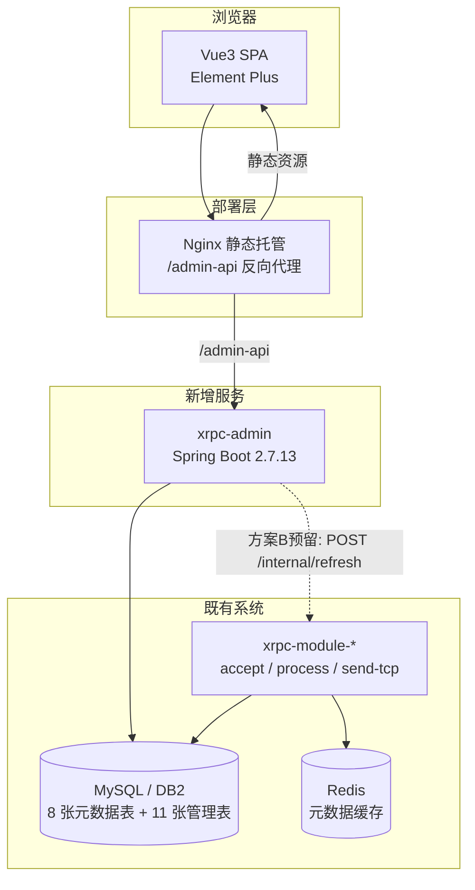
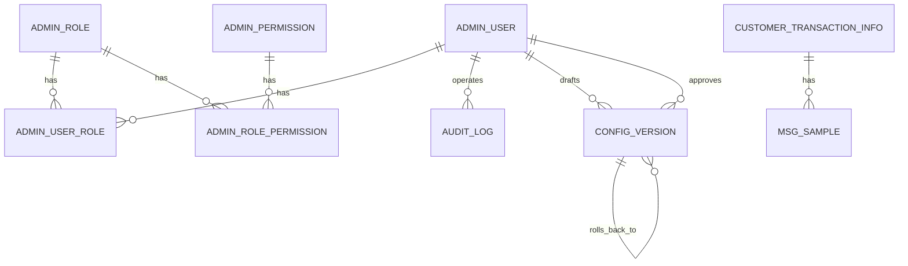
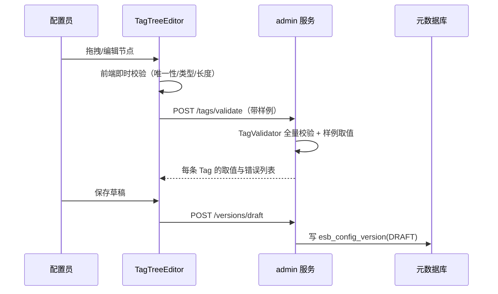
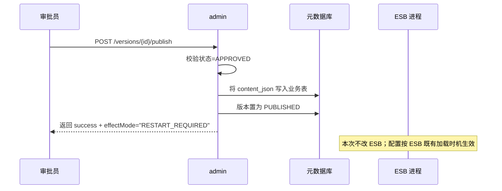
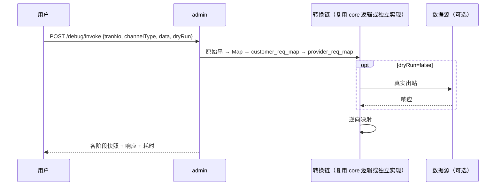

# 07 前台管理系统概要设计

| 版本 | 日期 | 状态 |
|---|---|---|
| v1.0 | 2026-11-22 | 已确认：Vue3 + Element Plus + 独立 admin 服务 |

## 1. 设计目标与原则

1. **零侵入**：不改现有 ESB 运行进程；控制台作为独立工程访问同一元数据库。
2. **元数据同源**：直接复用 `com.xs.datamodel.*` 实体，避免前台自定义一套字段造成漂移。
3. **两段式配置**：草稿与生效分离，先校验、后发布，天然支持版本与回滚。
4. **树形可编辑**：把扁平的 `parentTag` 路径包装成可操作的树。
5. **契约先行**：配置生效按方案 B 的接口契约预留，方案 A 下仅做提示。
6. **最小权限**：按钮级鉴权 + 全量审计。

## 2. 总体架构



架构要点：

- 控制台**不写 Redis**，也不直接操作 ESB 进程的缓存；
- 发布即写业务表（方案 A），是否生效由 ESB 的加载时机决定；
- 未来升级方案 B 时，admin 在发布成功后调用各实例的 `/internal/refresh`，前端无需改动。

## 3. 技术选型

| 层次 | 选型 | 说明 |
|---|---|---|
| 前端框架 | Vue 3 + TypeScript + Vite | 组合式 API，类型安全 |
| UI 组件 | Element Plus | 树、表格、表单、弹窗齐全 |
| 状态管理 | Pinia | 用户、字典、配置草稿 |
| 路由 | Vue Router 4 | 动态路由按权限生成 |
| HTTP | Axios | 统一拦截 token / 错误码 / traceId |
| 代码编辑 | CodeMirror 6（或 textarea 降级） | JSON/XML 样例编辑 |
| 映射可视化 | Vue Flow | 字段连线（P1，可降级为双栏对照） |
| 后端 | Spring Boot 2.7.13 + Java 8 + Spring Data JPA | 与 ESB 一致 |
| 安全 | Spring Security + JWT | 无状态认证 |
| API 文档 | springdoc-openapi 1.7 | Swagger UI |
| 构建 | Maven（独立 pom） | 不注册进现有 reactor |

## 4. 模块划分

### 4.1 前端工程 `xrpc-admin-web`

```text
xrpc-admin-web/
├─ index.html
├─ package.json
├─ vite.config.ts
├─ tsconfig.json
└─ src/
   ├─ main.ts
   ├─ App.vue
   ├─ api/          request.ts / auth.ts / channel.ts / tag.ts / version.ts / log.ts ...
   ├─ mock/         mockServer.ts（无后端时可运行演示）
   ├─ router/       index.ts / routes.ts
   ├─ store/        user.ts / app.ts / dict.ts
   ├─ layout/       index.vue / Sidebar.vue / Header.vue
   ├─ components/   TagTreeEditor.vue / MappingView.vue / CodePanel.vue / PageHeader.vue
   ├─ views/
   │   ├─ login/index.vue
   │   ├─ dashboard/index.vue
   │   ├─ config/ChannelList.vue / CustomerTransactionList.vue / ProviderTransactionList.vue
   │   ├─ config/TagConfig.vue / MappingView.vue / SampleList.vue / VersionList.vue
   │   ├─ monitor/TranLogList.vue / DebugPanel.vue / CacheStatus.vue
   │   └─ system/ErrorCodeList.vue / KeyList.vue / CPortConfig.vue / LogSwitch.vue
   │       / UserList.vue / RoleList.vue / AuditLog.vue
    │   └─ tools/Simulator.vue（接口模拟器：HTTP / TCP 发报）
   └─ utils/        tagTree.ts / validate.ts / format.ts
```

### 4.2 后端工程 `xrpc-admin`

```text
xrpc-admin/
├─ pom.xml
└─ src/main/java/com/xs/admin/
   ├─ XrpcAdminApplication.java
   ├─ common/       R.java / PageResult.java / DefineException.java / BizCode.java
   ├─ config/       SecurityConfig.java / OpenApiConfig.java / WebConfig.java
   ├─ security/     JwtUtil.java / JwtFilter.java / UserDetailsServiceImpl.java
   ├─ aop/          AuditAspect.java
   ├─ entity/       AdminUser / AdminRole / AdminPermission / ConfigVersion /
   │                AuditLog / ErrorCode / MsgSample / KeyStore / CPortConfig / LogSwitch
   ├─ dto/          ChannelDTO / CustomerTransactionDTO / ProviderTransactionDTO /
   │                TagDTO / TagValidateResult / VersionDTO / DebugDTO
   ├─ repository/   GenericRepository（管理表与 com.xs.datamodel 元数据表共用）
   ├─ service/      ChannelService / CustomerTransactionService / ProviderTransactionService /
   │                TagService / TagValidator / VersionService / LogService / DebugService /
   │                KeyService / CPortService / AuditService / UserService
   ├─ controller/   AuthController / ChannelController / CustomerTransactionController /
   │                ProviderTransactionController / TagController / VersionController /
   │                LogController / DebugController / DictController / SystemController
   └─ resources/    application.yml / application-dev.yml
```

## 5. 数据架构

### 5.1 复用的既有表

8 张：`esb_customer_sysname`、`esb_customer_transaction_info`、`esb_customer_request_tag`、`esb_customer_response_tag`、`esb_provider_transaction_info`、`esb_provider_request_tag`、`esb_provider_response_tag`、`esb_tran_log`。

### 5.2 新增管理表



| 表 | 核心字段 |
|---|---|
| `esb_admin_user` | id, username, password_hash, salt, real_name, status, last_login_time |
| `esb_admin_role` | id, role_code, role_name, remark |
| `esb_admin_user_role` | user_id, role_id |
| `esb_admin_permission` | id, parent_id, perm_code, perm_name, type(menu/button), path, component, sort |
| `esb_admin_role_permission` | role_id, permission_id |
| `esb_admin_audit_log` | id, operator, operate_time, ip, module, action, target, before_json, after_json, result |
| `esb_config_version` | id, env, target_type, target_key, version_no, status, content_json, diff_json, draft_by, approve_by, publish_time, remark |
| `esb_error_code` | id, code, message, module, suggestion, status |
| `esb_msg_sample` | id, tran_no, sample_type, content, remark |
| `esb_key_store` | id, channel, key_type, fingerprint, cipher_ref, status, expire_time |
| `esb_cport_config` | id, trannos, address, port, charset, fixedlength, type, str1~str5 |
| `esb_log_switch` | id, log_type, enabled, remark |

## 6. 接口设计概览

统一前缀 `/admin-api`，统一响应 `R{code, message, data, traceId}`，分页 `PageResult{page, size, total, records}`。

| 分组 | 接口 |
|---|---|
| 认证 | `POST /auth/login`、`POST /auth/logout`、`GET /auth/me`、`GET /auth/permissions` |
| 渠道 | `GET/POST/PUT /channels`、`DELETE /channels/{id}`、`PATCH /channels/{id}/status` |
| 渠道接口 | `GET/POST/PUT /customer-transactions`、`DELETE /customer-transactions/{id}`、`POST /customer-transactions/{id}/copy` |
| 数据源接口 | `GET/POST/PUT /provider-transactions`、`DELETE /provider-transactions/{id}` |
| Tag | `GET /tags`、`PUT /tags/batch`、`POST /tags/validate`、`POST /tags/preview`、`POST /tags/infer`、`POST /tags/copy` |
| 映射 | `GET /mapping/compare?tranNo=` |
| 样例 | `GET/POST/PUT/DELETE /samples` |
| 版本 | `POST /versions/draft`、`POST /versions/{id}/validate`、`GET /versions/{id}/diff`、`POST /versions/{id}/approve`、`POST /versions/{id}/publish`、`POST /versions/{id}/rollback`、`GET /versions` |
| 日志 | `GET /tran-logs`、`GET /tran-logs/{serid}`、`GET /tran-logs/export` |
| 调试 | `POST /debug/invoke` |
| 字典 | `GET/POST/PUT /error-codes`、`GET/PUT /log-switches` |
| 密钥 | `GET/POST /keys`、`POST /keys/{id}/rotate`、`PATCH /keys/{id}/status` |
| 端口映射 | `GET/POST/PUT/DELETE /cport` |
| 接口模拟器 | `POST /simulator/http`、`POST /simulator/tcp`（由 admin 代理发报，支持 `[6位长度][报文]`） |
| 运维 | `GET /cache/status`、`POST /cache/refresh`（方案 B 预留） |
| 用户与审计 | `GET/POST/PUT /users`、`GET/POST/PUT /roles`、`GET /permissions`、`GET /audit-logs` |

## 7. 关键流程设计

### 7.1 Tag 配置保存流程



### 7.2 发布流程（方案 A）



升级方案 B 时，在 `A-->>U` 之前增加：`A->>E: POST /internal/refresh`，并把 `effectMode` 改为 `REFRESHED`；前端根据 `effectMode` 显示不同提示，无需改代码。

### 7.3 在线调试流程



## 8. 前端设计要点

| 页面 | 关键交互 |
|---|---|
| 工作台 | 卡片式指标 + 待办列表 + 最近变更时间线 |
| 列表页 | 统一查询栏 + 表格 + 分页 + 批量启停；Element Plus `el-table` |
| Tag 配置 | 左：交易树；中：`el-tree` 可拖拽 Tag 树；右：属性面板；底部：校验结果 + 样例预览 |
| 映射视图 | 双栏对照，按 `tagMapping` 对齐；不一致项高亮 |
| 发布管理 | 版本列表 + 差异弹窗（并排 JSON diff）+ 审批/发布/回滚按钮 |
| 日志 | 时间范围 + 多条件筛选；详情抽屉展示四段报文 |
| 调试 | 左输入报文，右阶段结果折叠面板 |

组件复用：`PageHeader`、`SearchForm`、`StatusTag`、`CodePanel`、`TagTreeEditor`、`VersionDiff`。

## 9. 部署设计

| 方式 | 说明 |
|---|---|
| 推荐 | 前端 `npm run build` → `dist/` 交 Nginx 托管；`/admin-api` 反代到 admin 服务 |
| 备选 | 前端 `dist/` 复制到 `xrpc-admin/src/main/resources/static/`，由 admin 服务单进程托管 |
| 环境变量 | `SPRING_DATASOURCE_URL` / `ADMIN_JWT_SECRET` / `ESB_REFRESH_ENDPOINTS`（方案 B 预留） |

## 10. 安全设计

- JWT 无状态认证，密码 BCrypt 加盐；
- 路由守卫 + 后端 `@PreAuthorize` 双重校验；
- 操作审计用 AOP 自动记录，敏感字段（密码、密钥）脱敏；
- 日志详情中的报文按后台既有 `LogUtil` 规则脱敏；
- `clazz` 只能从白名单选择，避免数据库写入任意 Bean 名。

## 11. 演进路线

| 阶段 | 内容 |
|---|---|
| P1 | 工作台、渠道/接口 CRUD、Tag 编辑器、版本草稿（Mock 可演示） |
| P2 | admin 服务接真实库、发布/回滚、审计、权限 |
| P3 | 日志、调试、字典、密钥、端口映射、日志开关 |
| P4 | 方案 B 刷新、审批流、多环境、监控看板 |

## 12. 架构决策记录

| 编号 | 决策 | 理由 |
|---|---|---|
| ADR-01 | 独立工程，不改现有 reactor | 遵循「先不改后台」，且规避 P0-01 |
| ADR-02 | 复用 com.xs.datamodel 实体 | 字段同源，避免映射失真 |
| ADR-03 | 草稿 + 发布两段式 | 版本/回滚/审批的天然载体 |
| ADR-04 | 方案 A 先落地，契约按 B 设计 | 零侵入与未来可升级兼得 |
| ADR-05 | Tag 用树形编辑器 | 扁平 parentTag 对人不友好 |
| ADR-06 | Mock 层可切换 | 无后端环境也能演示与验收 UI |
